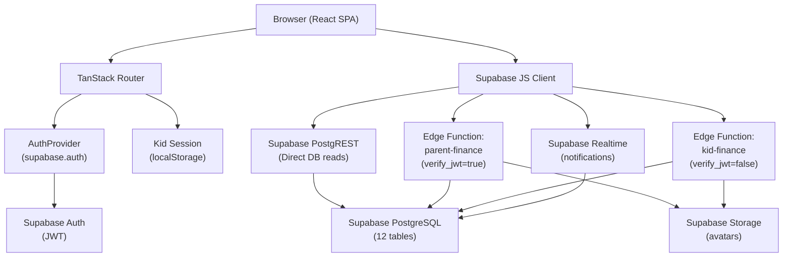
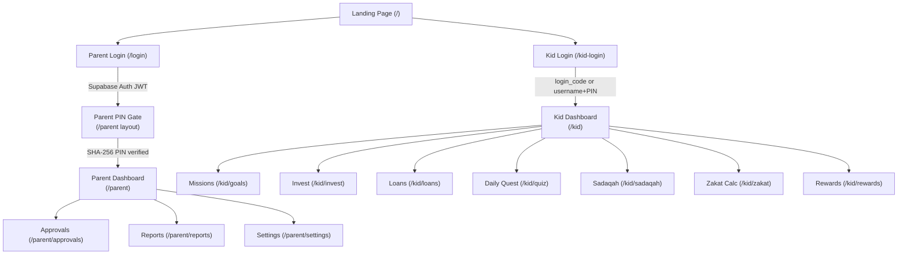
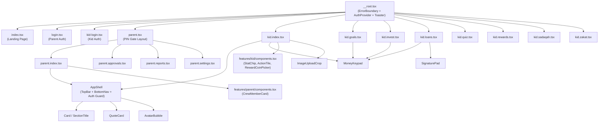

# Technical Architecture & Audit Report

## 1. Executive Summary

Centsibility is a **Single-Page Application (SPA)** built with React 19 and TanStack Router, bundled by Vite 7 and deployed via the Cloudflare Vite plugin. The backend is entirely serverless: all financial mutations are routed through two Supabase Edge Functions (`parent-finance` and `kid-finance`), while read-heavy parent data is fetched directly from Supabase PostgREST. Authentication is handled by Supabase Auth (email/password) for parents, and by a custom session-token/login-code scheme for kids (stored in `localStorage`). The package manager is **npm** (evidenced by `package-lock.json`). Notable specialized libraries include `jsPDF ^4.2.1` for in-browser loan PDF generation, `react-easy-crop ^5.5.7` for avatar image cropping, `framer-motion ^12.38.0` for animated UI, `recharts ^2.15.4` for investment charts, `bcryptjs ^3.0.3` for PIN hashing, and the Web Audio API (no external library) for gamified sound effects.

---

## 2. Project Structure

### Directory Mapping

- **`src/`** — Application source root
  - **`assets/`** — Static image assets (`centi-mascot.png`, `penny-mascot.png`)
  - **`components/`** — Shared, reusable UI components
    - `AppShell.tsx` — Top bar, bottom nav, auth guard wrapper for both kid and parent modes
    - `AvatarBubble.tsx` — Renders emoji or image-based user avatars
    - `ErrorBoundary.tsx` — React class-based error boundary
    - `ImageUploadCrop.tsx` — Avatar upload with `react-easy-crop` integration
    - `MoneyKeypad.tsx` — Numeric keypad for monetary input
    - `QuoteCard.tsx` — Daily Islamic finance quote display
    - `SignaturePad.tsx` — Canvas-based digital signature for loan agreements
    - **`ui/`** — shadcn/ui primitives (`skeleton.tsx`, `sonner.tsx`)
  - **`features/`** — Feature-scoped component bundles
    - `kid/components.tsx` — Kid-specific UI atoms (StatChip, ActionTile, RewardCoinPicker, etc.)
    - `parent/components.tsx` — Parent-specific UI atoms (CrewMemberCard, etc.)
  - **`firebase/`** — `firestore.rules` — Firestore security rules (present but Firestore is not the active database; Supabase is used instead)
  - **`hooks/`** — Custom React hooks
    - `use-kid-data.ts` — Polls `kid-finance` edge function every 20 s; notifies kid of parent decisions
    - `use-parent-data.ts` — Polls Supabase PostgREST every 20 s for all parent data
  - **`integrations/supabase/`** — Supabase client and generated types
    - `client.ts` — Lazy-initialised Supabase client via `Proxy`; supports both Vite and SSR env vars
    - `client.server.ts` — Server-side Supabase client variant
    - `types.ts` — Full auto-generated TypeScript types for all DB tables
  - **`lib/`** — Pure utility and business-logic modules
    - `edge.ts` — Typed wrappers for all Supabase Edge Function calls
    - `kid-session.ts` — Kid `localStorage` session with 24 h sliding TTL
    - `loan-pdf.ts` — `jsPDF`-based loan agreement / receipt PDF generator
    - `math.ts` — Investment growth simulation and loan repayment helpers
    - `quiz-bank.ts` — 200 financial-literacy questions (static, client-side)
    - `quotes.ts` — 200 Islamic finance quotes; deterministic daily selection
    - `sounds.ts` — Web Audio API SFX engine (no external dependency)
    - `theme.ts` — Light/dark theme toggle persisted to `localStorage`
    - `quick-login.ts` — Convenience parent PIN re-login stored in `localStorage`
    - `utils.ts` — General utility helpers
    - `empty.ts` — Placeholder / empty module
  - **`providers/`**
    - `auth.tsx` — `AuthProvider` wrapping `supabase.auth.onAuthStateChange`; exposes `useAuth()`
  - **`routes/`** — TanStack Router file-based routes
    - `__root.tsx` — Root layout: `AuthProvider`, `Toaster`, `ErrorBoundary`, theme init
    - `index.tsx` — Public landing page (Centsibility marketing site)
    - `login.tsx` — Parent email/password sign-in and sign-up
    - `kid-login.tsx` — Kid login via 6-char code or username + PIN
    - `kid.index.tsx` — Kid home dashboard
    - `kid.goals.tsx` — Savings goals ("Missions")
    - `kid.invest.tsx` — Investment module with risk/frequency controls and Recharts chart
    - `kid.loans.tsx` — Qard loan request (with signature) and repayment
    - `kid.quiz.tsx` — Daily financial literacy quiz
    - `kid.rewards.tsx` — Reward redemption with Stardust points
    - `kid.sadaqah.tsx` — Sadaqah (charity) donation flow
    - `kid.wallet.tsx` — Transaction history wallet view
    - `kid.zakat.tsx` — Zakat 2.5% calculator
    - `parent.tsx` — Parent layout route with PIN gate (4–6 digit, SHA-256 hashed, 30 min session)
    - `parent.index.tsx` — Parent command center dashboard
    - `parent.approvals.tsx` — Approve/decline kid deposit, withdrawal, loan, reward requests
    - `parent.reports.tsx` — Per-child financial statement generation
    - `parent.settings.tsx` — Hibah rate, invest rate, avatar, scheduled Hibah configuration
  - `main.tsx` — React DOM entry point; triggers scheduled Hibah cron on load
  - `router.tsx` — TanStack Router instance with `DefaultErrorComponent`

### Architecture Summary

The frontend is built with **React 19** using **TanStack Router v1** for file-based, type-safe client-side routing. The build tool is **Vite 7** with the `@cloudflare/vite-plugin` for Cloudflare Workers/Pages deployment. There is no dedicated state management library; server state is managed by custom polling hooks (`useKidData`, `useParentData`) using `fast-deep-equal` for referential stability, and local UI state is handled with `useState`/`useEffect`. The backend paradigm is **serverless**: all financial writes go through Supabase Edge Functions (`parent-finance`, `kid-finance`), while reads use Supabase's PostgREST client directly. The database is **Supabase (PostgreSQL)** with a `public` schema containing 12 tables. Authentication uses **Supabase Auth** for parents (JWT-based, persisted to `localStorage`) and a custom `session_token`/`login_code` scheme for kids (no Supabase Auth account required for children).

---

## 3. Application Flowcharts

### System Architecture & Data Flow

### User Journey Flow

### Frontend Component Hierarchy

---

## 4. Technology & Dependency Inventory

### Core Frameworks & Runtimes

| Dependency | Version | Purpose / Notes | Direct/Transitive |
|---|---|---|---|
| `react` | ^19.2.0 | UI rendering library | Direct |
| `react-dom` | ^19.2.0 | React DOM renderer | Direct |
| `@tanstack/react-router` | ^1.168.0 | Type-safe file-based client-side router | Direct |
| `@tanstack/react-start` | ^1.167.14 | TanStack Start SSR/SPA framework primitives | Direct |
| `@tanstack/router-plugin` | ^1.167.10 | Vite plugin for route tree generation | Direct |
| `vite` | ^7.3.1 | Build tool and dev server | Direct (dev) |
| `@vitejs/plugin-react` | ^5.0.4 | Vite React Fast Refresh plugin | Direct (dev) |
| `@cloudflare/vite-plugin` | ^1.25.5 | Cloudflare Workers/Pages deployment adapter | Direct |
| `typescript` | ^5.8.3 | TypeScript compiler | Direct (dev) |

### State Management & Data Fetching

| Dependency | Version | Purpose / Notes | Direct/Transitive |
|---|---|---|---|
| `@tanstack/react-query` | ^5.83.0 | Installed but not actively used in reviewed code; polling is done via custom hooks | Direct |
| `fast-deep-equal` | ^3.1.3 | Deep equality check to prevent unnecessary re-renders in polling hooks | Direct |
| `react-hook-form` | ^7.71.2 | Form state management | Direct |
| `@hookform/resolvers` | ^5.2.2 | Zod schema resolvers for react-hook-form | Direct |
| `zod` | ^3.24.2 | Runtime schema validation | Direct |

### Backend / Server & APIs

| Dependency | Version | Purpose / Notes | Direct/Transitive |
|---|---|---|---|
| `@supabase/supabase-js` | ^2.105.3 | Supabase client: Auth, PostgREST, Edge Functions, Realtime, Storage | Direct |
| `dotenv` | ^17.4.2 | Environment variable loading for scripts/seed | Direct |
| `9router` | ^0.4.59 | Purpose not detected in reviewed source files | Direct |

### UI / Styling

| Dependency | Version | Purpose / Notes | Direct/Transitive |
|---|---|---|---|
| `tailwindcss` | ^4.2.1 | Utility-first CSS framework | Direct |
| `@tailwindcss/vite` | ^4.2.1 | Vite integration for Tailwind CSS v4 | Direct |
| `tw-animate-css` | ^1.3.4 | Pre-built Tailwind animation utilities | Direct |
| `tailwind-merge` | ^3.5.0 | Merges conflicting Tailwind class names | Direct |
| `class-variance-authority` | ^0.7.1 | Variant-based className builder (shadcn/ui) | Direct |
| `clsx` | ^2.1.1 | Conditional className utility | Direct |
| `@radix-ui/react-accordion` | ^1.2.12 | Accessible accordion primitive | Direct |
| `@radix-ui/react-alert-dialog` | ^1.1.15 | Accessible alert dialog primitive | Direct |
| `@radix-ui/react-aspect-ratio` | ^1.1.8 | Aspect ratio container | Direct |
| `@radix-ui/react-avatar` | ^1.1.11 | Avatar primitive | Direct |
| `@radix-ui/react-checkbox` | ^1.3.3 | Checkbox primitive | Direct |
| `@radix-ui/react-collapsible` | ^1.1.12 | Collapsible primitive | Direct |
| `@radix-ui/react-context-menu` | ^2.2.16 | Context menu primitive | Direct |
| `@radix-ui/react-dialog` | ^1.1.15 | Dialog/modal primitive | Direct |
| `@radix-ui/react-dropdown-menu` | ^2.1.16 | Dropdown menu primitive | Direct |
| `@radix-ui/react-hover-card` | ^1.1.15 | Hover card primitive | Direct |
| `@radix-ui/react-label` | ^2.1.8 | Label primitive | Direct |
| `@radix-ui/react-menubar` | ^1.1.16 | Menubar primitive | Direct |
| `@radix-ui/react-navigation-menu` | ^1.2.14 | Navigation menu primitive | Direct |
| `@radix-ui/react-popover` | ^1.1.15 | Popover primitive | Direct |
| `@radix-ui/react-progress` | ^1.1.8 | Progress bar primitive | Direct |
| `@radix-ui/react-radio-group` | ^1.3.8 | Radio group primitive | Direct |
| `@radix-ui/react-scroll-area` | ^1.2.10 | Scroll area primitive | Direct |
| `@radix-ui/react-select` | ^2.2.6 | Select primitive | Direct |
| `@radix-ui/react-separator` | ^1.1.8 | Separator primitive | Direct |
| `@radix-ui/react-slider` | ^1.3.6 | Slider primitive | Direct |
| `@radix-ui/react-slot` | ^1.2.4 | Slot/asChild primitive | Direct |
| `@radix-ui/react-switch` | ^1.2.6 | Switch primitive | Direct |
| `@radix-ui/react-tabs` | ^1.1.13 | Tabs primitive | Direct |
| `@radix-ui/react-toggle` | ^1.1.10 | Toggle primitive | Direct |
| `@radix-ui/react-toggle-group` | ^1.1.11 | Toggle group primitive | Direct |
| `@radix-ui/react-tooltip` | ^1.2.8 | Tooltip primitive | Direct |
| `lucide-react` | ^0.575.0 | Icon library (installed; `@phosphor-icons/react` is used in reviewed code) | Direct |
| `@phosphor-icons/react` | ^2.1.10 | Primary icon library used throughout the app | Direct |
| `sonner` | ^2.0.7 | Toast notification library | Direct |
| `vaul` | ^1.1.2 | Drawer/sheet component | Direct |
| `cmdk` | ^1.1.1 | Command palette component | Direct |
| `input-otp` | ^1.4.2 | OTP/PIN input component | Direct |
| `react-resizable-panels` | ^4.6.5 | Resizable panel layout | Direct |
| `embla-carousel-react` | ^8.6.0 | Carousel component | Direct |
| `react-day-picker` | ^9.14.0 | Date picker component | Direct |

### Specialized Libraries (Visuals, Data, PDF, Charts, etc.)

| Dependency | Version | Purpose / Notes | Direct/Transitive |
|---|---|---|---|
| `framer-motion` | ^12.38.0 | Animation library; used for goal progress bars, balloon effects, bottom nav transitions | Direct |
| `recharts` | ^2.15.4 | Chart library; used for 7-day investment `AreaChart` in `kid.invest.tsx` | Direct |
| `jspdf` | ^4.2.1 | Client-side PDF generation; used in `loan-pdf.ts` for loan agreements and receipts | Direct |
| `html2canvas` | ^1.4.1 | HTML-to-canvas screenshot; installed, not detected in reviewed source files | Direct |
| `react-easy-crop` | ^5.5.7 | Image crop UI for avatar upload in `ImageUploadCrop.tsx` | Direct |
| `browser-image-compression` | ^2.0.2 | Client-side image compression before avatar upload | Direct |
| `bcryptjs` | ^3.0.3 | bcrypt hashing; used in `seed.ts` and scratch scripts | Direct |
| `date-fns` | ^4.1.0 | Date utility library | Direct |

### Testing & Quality

| Dependency | Version | Purpose / Notes | Direct/Transitive |
|---|---|---|---|
| `vitest` | ^4.1.6 | Unit test runner | Direct (dev) |
| `@playwright/test` | ^1.60.0 | End-to-end test framework | Direct (dev) |
| `eslint` | ^9.32.0 | JavaScript/TypeScript linter | Direct (dev) |
| `@eslint/js` | ^9.32.0 | ESLint core JS rules | Direct (dev) |
| `typescript-eslint` | ^8.56.1 | TypeScript ESLint rules | Direct (dev) |
| `eslint-plugin-react-hooks` | ^5.2.0 | React Hooks lint rules | Direct (dev) |
| `eslint-plugin-react-refresh` | ^0.4.20 | React Fast Refresh lint rules | Direct (dev) |
| `eslint-config-prettier` | ^10.1.1 | Disables ESLint rules conflicting with Prettier | Direct (dev) |
| `eslint-plugin-prettier` | ^5.2.6 | Runs Prettier as an ESLint rule | Direct (dev) |
| `prettier` | ^3.7.3 | Code formatter | Direct (dev) |
| `globals` | ^15.15.0 | Global variable definitions for ESLint | Direct (dev) |
| `vite-plugin-node-polyfills` | ^0.27.0 | Node.js polyfills for browser (e.g., `process.env`) | Direct (dev) |
| `vite-tsconfig-paths` | ^6.0.2 | Resolves TypeScript path aliases in Vite | Direct (dev) |

---

## 5. Detailed Architectural Breakdown

### A. Data Flow and State Strategy

The app uses **no global client-state library** (Redux, Zustand, Jotai, etc.). State is managed at three levels:

- **Server state (parent):** `useParentData` (`src/hooks/use-parent-data.ts`) fetches all parent data (kids, approvals, rewards, loans, transactions, notifications, scheduled Hibahs) via parallel `supabase.from(...)` PostgREST calls. It polls every 20 seconds and uses `fast-deep-equal` to skip re-renders when data is unchanged. Supabase Realtime is used additionally in `AppShell.tsx` to push unread notification counts instantly via `postgres_changes` subscription.

- **Server state (kid):** `useKidData` (`src/hooks/use-kid-data.ts`) fetches all kid state via the `kid-finance` edge function's `get-state` action. It also polls every 20 seconds, pauses when the tab is hidden (`document.visibilityState`), and fires toast notifications when parent decisions (approvals, rewards) are detected as newly resolved.

- **Global client state:** `AuthProvider` (`src/providers/auth.tsx`) holds the Supabase `Session` and `User` objects in React context, updated via `onAuthStateChange`. Kid session is stored in `localStorage` via `src/lib/kid-session.ts` with a 24-hour sliding TTL.

- **Local component state:** All UI state (modals, form inputs, loading flags) is managed with `useState` within individual route components. `@tanstack/react-query` is installed but not used in the reviewed source files.

### B. Authentication & Security

**Parent authentication** uses Supabase Auth (email/password). The JWT is automatically attached by `supabase.functions.invoke()` to calls to `parent-finance`, which has `verify_jwt = true`. After JWT verification, the parent layout route (`parent.tsx`) adds a second layer: a 4–6 digit PIN hashed with `crypto.subtle.digest("SHA-256")` and stored in the `commander_pins` table. A verified PIN session is stored in `sessionStorage` for 30 minutes.

**Kid authentication** uses a custom scheme: kids log in via a 6-character `login_code` or `username + PIN`. The edge function validates credentials and returns a `session_token` (stored in the `kids` table). All subsequent kid requests pass this token as `code` in the request body. The `kid-finance` edge function has `verify_jwt = false`; it validates the `session_token` on every handler call. The kid session is stored in `localStorage` with a 24-hour sliding TTL (`src/lib/kid-session.ts`).

**Route protection** is enforced in `AppShell.tsx`: parent routes redirect to `/login` if no Supabase session exists; kid routes redirect to `/kid-login` if no kid session exists in `localStorage`.

**Database-level security:** The `src/firebase/firestore.rules` file is present but applies to Firestore, which is not the active database. Supabase Row Level Security (RLS) policies are not visible in the provided files (they would be defined in Supabase dashboard or migration files not present in this workspace). All financial mutations are funnelled through edge functions, which act as a server-side authorization boundary.

**Notable security concern:** `src/lib/quick-login.ts` stores the parent's plaintext email and password in `localStorage`, gated only by a PIN comparison done client-side. This is explicitly commented as "Demo-grade convenience layer; not a security boundary on its own."

### C. Key Modules & Responsibilities

**Auth Domain**
- Components/hooks: `src/providers/auth.tsx`, `src/routes/login.tsx`, `src/routes/kid-login.tsx`, `src/routes/parent.tsx`
- Data persistence: Supabase Auth (`auth.users`), `profiles` table, `commander_pins` table, `kids.session_token`, `kids.hashed_pin`, `kids.login_code`

**Kid Dashboard (Core Business Logic)**
- Components/hooks: `src/routes/kid.index.tsx`, `src/hooks/use-kid-data.ts`, `src/features/kid/components.tsx`
- Data persistence: `kids`, `transactions`, `approvals`, `rewards` tables via `kid-finance` edge function

**Savings Goals (Missions)**
- Components: `src/routes/kid.goals.tsx`
- Data persistence: `goals` table; direct Supabase client writes for add/edit/delete; `kid-finance` edge function for `contribute-goal` (deducts from balance)

**Investment Module (Cosmic Growth)**
- Components: `src/routes/kid.invest.tsx`
- Business logic: `src/lib/math.ts` (`calculateInvestmentGrowth` with risk-banded random returns)
- Data persistence: `kids.invest_balance`, `kids.invest_rate`, `kids.invest_last_paid` via `kid-finance` edge function actions (`invest-deposit`, `invest-withdraw`, `invest-settle`, `set-invest-risk`, `set-invest-frequency`)

**Loan System (Qard)**
- Components: `src/routes/kid.loans.tsx`, `src/components/SignaturePad.tsx`, `src/lib/loan-pdf.ts`
- Data persistence: `loans` table; signature stored as `signature_data_url` (base64 PNG); PDF generated client-side with `jsPDF`

**Parent Command Center**
- Components/hooks: `src/routes/parent.index.tsx`, `src/routes/parent.approvals.tsx`, `src/routes/parent.settings.tsx`, `src/routes/parent.reports.tsx`, `src/hooks/use-parent-data.ts`, `src/features/parent/components.tsx`
- Data persistence: `kids`, `approvals`, `rewards`, `loans`, `transactions`, `notifications`, `scheduled_hibahs` tables via `parent-finance` edge function and direct PostgREST reads

**Gamification (Quiz, Stardust, XP)**
- Components: `src/routes/kid.quiz.tsx`, `src/routes/kid.rewards.tsx`
- Business logic: `src/lib/quiz-bank.ts` (200 static questions), `src/lib/quotes.ts` (200 daily quotes)
- Data persistence: `kids.coins`, `kids.xp`, `kids.level`, `kids.streak`, `kids.quiz_correct`, `kids.quiz_wrong`, `kids.quiz_index`, `quiz_attempts` table

**Scheduled Hibah (Auto-gifting)**
- Components: `src/routes/parent.settings.tsx`
- Trigger: `src/lib/edge.ts` → `edgeExecuteScheduledHibahs()` called on app load (5 s delay) and every hour via `setInterval` in `src/main.tsx`
- Data persistence: `scheduled_hibahs` table

### D. Notable Design Patterns

1. **Provider Pattern** — `AuthProvider` (`src/providers/auth.tsx`) wraps the entire app in `__root.tsx`, exposing `useAuth()` context. This decouples auth state from individual route components.

2. **Layout Route with Gate** — `src/routes/parent.tsx` is a TanStack Router layout route that renders a PIN verification screen before passing control to `<Outlet />`. This is a clean implementation of the Layout Route pattern for multi-step auth.

3. **Adapter / Typed Facade** — `src/lib/edge.ts` is a typed adapter layer over `supabase.functions.invoke()`. Every edge function call is wrapped in a named, typed function (e.g., `edgeKidRepayLoan`, `edgeParentDeposit`), hiding the raw invocation details and providing compile-time safety.

4. **Polling with Referential Stability** — Both `useKidData` and `useParentData` implement a polling pattern with `setInterval` (20 s) combined with `fast-deep-equal` to prevent unnecessary React re-renders when the fetched data is structurally identical to the previous state. Tab visibility is checked to pause polling when the tab is hidden.

5. **Compound Component** — `AppShell` (`src/components/AppShell.tsx`) is a compound component that composes `TopBar`, `BottomNav`, auth guards, and a `<main>` content area. It accepts a `mode` prop (`"kid"` | `"parent"`) to switch between two distinct navigation configurations, keeping both modes in a single component.

---

## 6. External Resources & Submodules

**Git submodules:** None detected in provided files.

**Third-party API integrations:**
- **Supabase** — PostgreSQL database, Auth, Edge Functions (serverless), Realtime (WebSocket), Storage (avatar images). Configured via `VITE_SUPABASE_URL` and `VITE_SUPABASE_ANON_KEY` environment variables.
- **Cloudflare** — Deployment target via `@cloudflare/vite-plugin ^1.25.5`.

**External repos:** None detected in provided files.

---

## 7. Security & Maintenance Recommendations

1. **Bundle size / code-splitting for heavy libraries:** `framer-motion ^12.38.0` and `recharts ^2.15.4` are large libraries loaded on every route. Apply route-level lazy loading using `React.lazy()` and `Suspense` for routes that use them (`kid.goals.tsx` for Framer Motion, `kid.invest.tsx` for Recharts). This can reduce the initial JS bundle by 100–200 KB gzipped.

2. **Dynamic imports for large optional features:** `jsPDF ^4.2.1` is only needed when a user downloads a loan PDF. Import it dynamically inside `exportLoanPdf` in `src/lib/loan-pdf.ts` (`const { jsPDF } = await import("jspdf")`) so it is not included in the main bundle. Similarly, `react-easy-crop` in `ImageUploadCrop.tsx` should be lazy-loaded since avatar upload is an infrequent action.

3. **Security posture — quick-login credential storage:** `src/lib/quick-login.ts` stores the parent's plaintext `email` and `password` in `localStorage`. This is a significant security risk: any XSS vulnerability or malicious browser extension can exfiltrate these credentials. Replace this pattern with a Supabase `refresh_token` (already persisted by the Supabase client) combined with a client-side PIN check, eliminating the need to store the password at all.

4. **Dependency auditing and lockfile hygiene:** Run `npm audit` to check for known vulnerabilities. The `9router ^0.4.59` dependency has no detected usage in the reviewed source files — verify it is still needed and remove it if not, as unknown packages with low download counts are a supply-chain risk. Pin all dependencies to exact versions in `package.json` (remove `^` prefixes) for reproducible builds, especially for security-sensitive packages like `@supabase/supabase-js` and `bcryptjs`.

5. **Supabase Row Level Security (RLS) audit for the `goals` table:** In `src/routes/kid.goals.tsx`, the kid client calls `supabase.from("goals").insert(...)`, `supabase.from("goals").update(...)`, and `supabase.from("goals").delete(...)` **directly** using the anon key — bypassing the `kid-finance` edge function entirely. Unlike financial mutations (deposits, loans, rewards), these direct writes are not protected by the server-side session token validation that the edge function provides. Ensure RLS policies on the `goals` table strictly enforce that `kid_id` matches the authenticated session, or migrate these operations into the `kid-finance` edge function to maintain a consistent server-side authorization boundary.
